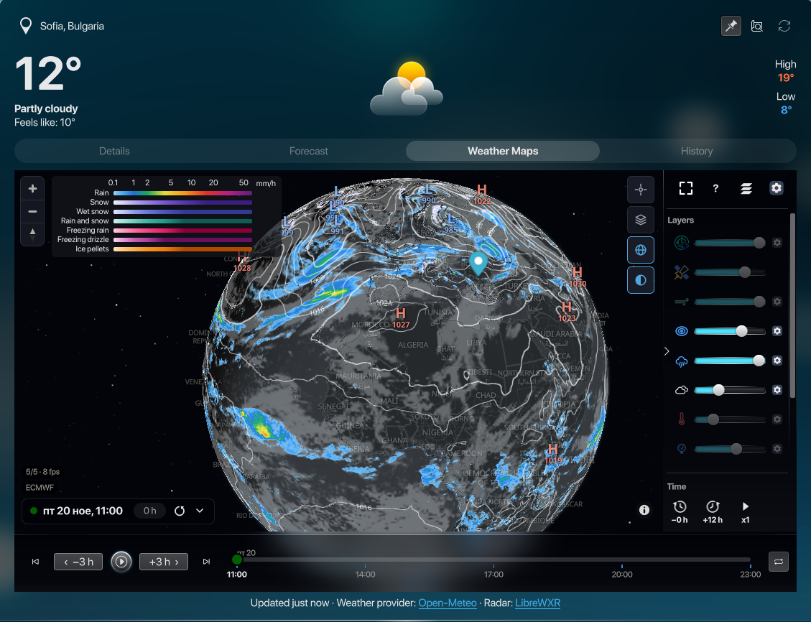
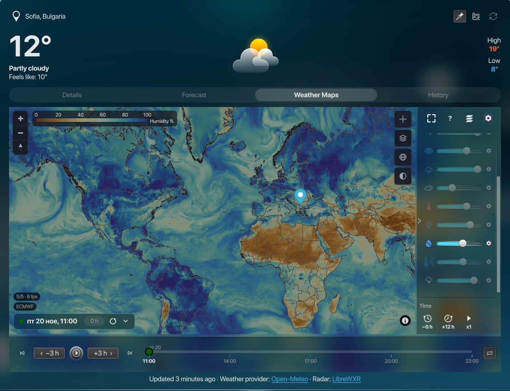

# Advanced Weather Widget for KDE Plasma 6

A modern, highly customizable weather widget built specifically for KDE Plasma 6.

### Why this widget?
*   **Granular Precision:** Uses exact Latitude/Longitude coordinates for local data rather than generic city-level lookups.
*   **Modern UX:** A clean, native-feeling interface with smooth animations and intuitive layouts.
*   **Feature Rich:** From interactive weather maps and air quality to space weather and moon phases - everything is configurable.
*   **KDE Notifications support:** Stay informed with KDE notifications for weather alerts, forecasts, the UV index, and the Kp index. All notifications can be individually configured.

## 📑 Table of Contents
- [📦 Installation](#-installation)
  - [⚠️ Prerequisites & Dependencies](#-prerequisites--dependencies)
  - [🛍 Install from KDE Store](#-install-from-kde-store-recommended)
  - [🛠 Manual Installation](#-manual-installation-development)
- [🖼️ Screenshots](#-screenshots)
- [✨ Detailed Features](#-detailed-features)
- [💻 Code Contributors](#-code-contributors)
- [🌐 Translation](#-translation)
- [📦 Data Sources](#-data-sources)
- [🔑 Entering API Keys](#-entering-api-keys)
- [🐛 Bug Reports & Feedback](#-bug-reports--feedback)
- [🔒 Privacy](#-privacy)
- [❤️ Support](#-support-the-project)
- [📜 License](#-license)

---

# 📦 Installation

## ⚠️ Prerequisites & Dependencies
For the full functionality of this widget, please ensure you have the following Qt6 modules installed for your distribution:

### 📍 Location & Search
*Required for the Location map screen and GeoClue2 auto-detection.*

| Distribution | Package Name |
|---|---|
| **Fedora / RHEL** | `qt6-qtlocation` |
| **openSUSE** | `qt6-location` |
| **Arch Linux** | `qt6-location` |
| **Debian / Kubuntu / KDE Neon** | `qml6-module-qtlocation` `qml6-module-qtpositioning` |

### 📡 Weather maps
*Required for the interactive Weather maps tab (Chromium-based).*

| Distribution | Package Name |
|---|---|
| **Fedora / RHEL** | `qt6-qtwebengine` |
| **openSUSE** | `qt6-webengine` |
| **Arch Linux** | `qt6-webengine` |
| **Debian / Kubuntu / KDE Neon** | `qml6-module-qtwebengine` |

> Some users have reported that KDE Plasma crashes when opening the Weather maps tab or the map in the location selection dialog.  On some hybrid-GPU laptops running Wayland, the Weather maps tab's embedded browser view can crash the entire *plasmashell* the first time it renders, due to a driver-level conflict between the two GPUs. This option disables GPU-accelerated compositing inside the browser view to prevent the crash.
> The problem is not caused by the widget itself, but by certain versions of QtWebEngine.
> To enable this workaround, go to the widget settings -> General -> Workaround Weather maps map crashes on hybrid-GPU systems (EXPERIMENTAL).
> Only enable this option if you are actually experiencing this crash, as it may reduce rendering performance on the Weather maps map.
> You need to log out and log back in for this option to take effect, as the setting needs to be applied before Plasma starts. It also applies to the entire session, so any other application that embeds a Chromium-based browser view will use the same setting.
> If you enable this option, the following file will be created:

> ~/.config/plasma-workspace/env/advanced-weather-widget-radar-gpu-workaround.sh

> **MangoHud and other `LD_PRELOAD` overlays:** starting plasmashell under MangoHud (`mangohud plasmashell --replace`) has been observed to crash the whole shell when the embedded Weather maps starts. If the widget finds MangoHud in plasmashell's `LD_PRELOAD`, it does not load the embedded Weather maps. The Weather maps tab then shows an **Open Weather maps in browser** button and a **Load embedded Weather maps anyway** button, so you can still try it at your own risk.

### 📈 Charts (History tab and Forecast graphs)
*Required for the charts in the History tab and for the **Graphs** layouts of the daily and hourly forecast. You only need **one** of the two modules below.*

The History tab and the Graphs layouts of the Forecast tab draw their charts with **Qt Graphs** when it is available. If Qt Graphs is not installed (or your Qt is older than 6.8), the widget automatically falls back to **KDE Quick Charts**. If neither module is installed, the History tab still shows the summary tiles and the Forecast tab keeps its day rows, but a chart is replaced by a short message.

**Qt Graphs** (preferred, needs Qt 6.8 or newer):

| Distribution | Package Name |
|---|---|
| **Fedora / RHEL** | `qt6-qtgraphs` |
| **openSUSE** | `qt6-graphs-imports` |
| **Arch Linux** | `qt6-graphs` |
| **Debian / Kubuntu / KDE Neon** | `qml6-module-qtgraphs` |

**KDE Quick Charts** (fallback):

| Distribution | Package Name |
|---|---|
| **Fedora / RHEL** | `kf6-kquickcharts` |
| **openSUSE** | `kf6-kquickcharts` |
| **Arch Linux** | `kquickcharts` |
| **Debian / Kubuntu / KDE Neon** | `libquickcharts1` |

> KDE Quick Charts is part of KDE Frameworks, so it is already installed on most Plasma 6 systems. Qt Graphs is a separate Qt module and is usually the one you need to install. Distributions that ship an older Qt (for example Kubuntu 24.04 with Qt 6.4) do not provide Qt Graphs 6.8, so the widget uses KDE Quick Charts there.
> Restart Plasma after installing a module (`systemctl --user restart plasma-plasmashell`) so the widget can find it.

### 🔊 Alert Sounds
*Required to play a sound alongside weather-alert notifications.*

| Distribution | `pw-play` (PipeWire, preferred) | `paplay` (PulseAudio, fallback) |
|---|---|---|
| **Fedora / RHEL** | `pipewire-utils` | `pulseaudio-utils` |
| **openSUSE** | `pipewire-tools` | `pulseaudio-utils` |
| **Arch Linux** | `pipewire-audio` | `libpulse` |
| **Debian / Kubuntu / KDE Neon** | `pipewire-bin` | `pulseaudio-utils` |

> On a standard PipeWire desktop `pw-play` is usually installed already. Check with `command -v pw-play paplay`.

> The default sound is located in `/home/<your username>/.local/share/plasma/plasmoids/org.kde.plasma.advanced-weather-widget/contents/sounds/alert-default.ogg`
> Both players decode through libsndfile, so `.wav`, `.ogg` and `.flac` files are reliable. `.mp3` only works if your distribution's libsndfile was built with MP3 support (libsndfile 1.1 or newer); if an MP3 does not play, convert it to `.ogg` or `.wav`. Please test your sound in the widget settings before applying it, using the "Test" button in the notification settings. If no player is found, the Test button shows an error.

## 🛍 Install from KDE Store (Recommended)
1. Right-click your Panel or Desktop.
2. Select **Add Widgets...** -> **Get New Widgets** -> **Download New Plasma Widgets**.
3. Search for **Advanced Weather Widget**.
4. Click **Install**.

## 🛠 Manual Installation (Development)
If you prefer to install from source:
```bash
git clone https://github.com/pnedyalkov91/advanced-weather-widget.git && cd advanced-weather-widget
kpackagetool6 --type Plasma/Applet --install .
rm -rf ~/.cache/plasmashell/qmlcache
systemctl --user restart plasma-plasmashell
```

### Rebuilding the embedded LibreWXR radar map

The Weather maps tab embeds a page assembled from the KDE-widget glue fragments vendored in this repository under `scripts/librewxr-map-src/` plus the shared engine (`viewer-core.js`) and stylesheet (`viewer.css`) from the [LibreWXR](https://github.com/JoshuaKimsey/LibreWXR) checkout given via `--librewxr` (or `LIBREWXR_DIR`). After pulling changes from a LibreWXR checkout, regenerate it with:

```bash
python3 scripts/build_librewxr_map.py --librewxr /path/to/LibreWXR
```

`LIBREWXR_DIR` can be used instead of `--librewxr`. The script writes `contents/ui/components/librewxr-map.html` in place.

---

# 🖼️ Screenshots

### Panel layout styles
| Single line | Simple mode | XFCE style |
|:---:|:---:|:---:|
|  |  |  |
| A compact, one-row layout for a minimalist look. | Only the essential icon and current temperature. | A multiline display with an automatic scrollbox for detailed info. |

### Widget layouts
| Advanced mode (cards) | Advanced mode (list) |
|:---:|:---:|
| <video src="https://github.com/user-attachments/assets/ebad95fc-fb09-4e83-9db7-9eaf9e04df71" width="400" controls loop muted playsinline></video> |  |
| Animated cards (collapsed/expanded) | A clean list view |

| Simple mode (default) | Simple mode (graphs) | Super simple |
|:---:|:---:|:---:|
|  |  |  |
| Focused view for weather without the tabs | Forecast data shown with interactive graphs | The most minimal view |

### Forecast
| Standard daily / hourly cards | Standard daily / hourly graphs | Standard daily / hourly strip |
|:---:|:---:|:---:|
|  |  |  |

| Graph daily / hourly cards | Graph daily / hourly strip |
|:---:|:---:|
|  |  |

| Expanded graphs | Compact graphs |
|:---:|:---:|
| <video src="https://github.com/user-attachments/assets/ea31e407-8ad3-4e4d-93f9-be4018ffee4d" width="400" controls loop muted playsinline></video> | <video src="https://github.com/user-attachments/assets/e914e796-e6f0-461d-8e86-c1ba1cab921b" width="400" controls loop muted playsinline></video> |
| Expanded graphs for daily and hourly forecasts | Compact daily and forecast graphs |

### Weather Map
| Overview |
|:---:|
| <video src="https://github.com/user-attachments/assets/78316480-1346-43d8-83fb-fe6132170b40" width="800" controls loop muted playsinline></video> |

| Plain map | 3D globe with day and night | Radar and satellite |
|:---:|:---:|:---:|
|  |  |  |

| Isobars, rain and clouds | Temperature layer | Humidity |
|:---:|:---:|:---:|
|  |  |  |

| Dew point | Sea level pressure | Air quality |
|:---:|:---:|:---:|
|  |  |  |

## Weather History
| Overview |
|:---:|
| <video src="https://github.com/user-attachments/assets/103a2914-c315-4914-b3f4-e4b07c6dc299" width="800" controls loop muted playsinline></video> |

| Previous day | This year | Custom range |
|:---:|:---:|:---:|
|  |  |  |

### Notifications
| Regular and alert notifications | Tomorrow forecast |
|:---:|:---:|
|  |  |

# ✨ Detailed Features

### 📍 Location Management
- **Precision:** Automatic detection via GeoClue2 (with an HTTPS IP-lookup fallback, see [Privacy](#-privacy)) or manual search with [Photon](https://photon.komoot.io/); place names are resolved with [OpenStreetMap Nominatim](https://www.openstreetmap.org/).
- **Map Picker:** Integrated OpenStreetMap preview to pin your exact location.
- **Smart Data:** Automatic timezone, altitude detection, and localized city names.

### 🌦 Weather Providers & Adaptive Mode
- Choose from **12 different providers**, including free options (Open-Meteo, BBC Weather, met.no) and Key-required providers.
- **Adaptive Failover:** Automatically cycles through providers if one goes offline, ensuring you never have a widget without data.
- **National High-Res Models:** When using Open-Meteo, the widget automatically prefers your country's official high-resolution model (e.g. DWD ICON for Germany/Austria, Météo-France AROME, UK Met Office, NOAA GFS/HRRR, MeteoSwiss ICON-CH, MET Norway, Environment Canada GEM, JMA, KNMI, DMI, ItaliaMeteo ARPAE, CMA) for more precise local forecasts.

### 🔑 Entering API Keys
For providers that require an API key, you can enter it in the widget's settings:
1. Right-click on the widget in your panel or desktop.
2. Select **Configure Advanced Weather Widget**.
3. Navigate to the **General** settings.
4. Turn off **Adaptive** mode and choose your preferred provider.
5. Enter your API key in the corresponding field for your chosen provider.

| Provider | Key Required | Signup Link |
|---|:---:|---|
| **[Open-Meteo](https://open-meteo.com/) / [MET Norway](https://www.met.no/)** | No | - |
| **[BBC Weather](https://www.bbc.com/weather)** | No | - |
| **OpenWeatherMap** | ✅ | [Sign Up](https://openweathermap.org/api) |
| **WeatherAPI** | ✅ | [Sign Up](https://www.weatherapi.com/) |
| **Pirate Weather** | ✅ | [Sign Up](https://pirateweather.net/) |
| **Tomorrow.io** | ✅ | [Sign Up](https://www.tomorrow.io/weather-api/) |
| **Visual Crossing** | ✅ | [Sign Up](https://www.visualcrossing.com/weather-data) |
| **StormGlass** | ✅ | [Sign Up](https://stormglass.io/) |
| **Weatherbit** | ✅ | [Sign Up](https://www.weatherbit.io/) |
| **QWeather** | ✅ | [Sign Up](https://dev.qweather.com/) |
| **AEMET** | ✅ | [Sign Up](https://opendata.aemet.es/centrodedescargas/altaUsuario) |

### 🌡 Data Points
- **Core:** Temp (Current/Apparent/Dew), Wind (Speed/Direction), Humidity, Pressure, Visibility.
- **Environment:** UV Index, Air Quality (CAQI), Pollen (Universal Index), Space Weather (Kp index, G-index, aurora probability).
- **Astronomy:** Configurable Sun Arc (Sunrise/Set) and Moon Path (Phases/Rise/Set).
- **Alerts:** Real-time push notifications from MeteoAlarm, NOAA NWS, LibreWXR, KDE's FOSS Public Alert Server, and provider-specific sources, including a dedicated "Purple" tier for extreme-severity alerts. Starting with version 1.8.0, the widget supports sounds for alert notifications, which are fully configurable.

### 📈 History
- **Past weather:** Browse earlier days, weeks and months for your exact location, using the [Open-Meteo Historical Weather API](https://open-meteo.com/en/docs/historical-weather-api) (free, no key needed, independent of the provider you picked for the forecast).
- **Interactive charts:** Temperature, precipitation, wind and more, with zoom (mouse wheel, double-click, buttons) and drag to move through the period. Drawn with **Qt Graphs**, with **KDE Quick Charts** as an automatic fallback (see [Prerequisites](#-charts-history-tab-and-forecast-graphs)).
- **Summary tiles:** Average temperature, warmest day, coldest night, total precipitation, wettest day, strongest wind and gust, sunshine, humidity, pressure and cloud cover. Where Open-Meteo provides the hour, the tile also shows when it happened.

### 🖥 Customization
- **Dual Temperature:** Option to display two different temperature metrics simultaneously (e.g., Actual + Apparent).
- **Panel Layouts:** Single line, Multiline (XFCE weather applet style with scrollbox), or Simple (compact icon + temp).
- **Widget Layouts:** Advanced (Details, Forecast, History and Weather maps tabs) and Simple (no tabs)
- **Themes:** 7 icon themes (Symbolic, Font, Flat, 3D, Meteocons, KDE) plus a custom per-item picker, with an optional adjustable glow effect for weather icons.
- **Forecast layouts:** The daily forecast can be shown as **Standard** rows or as **Graphs** (high/low temperature lines, precipitation bars and a weather icon per day; click a day to open its hours). The hourly forecast can be **Cards**, **Strip** or **Graphs** (temperature line, chance of precipitation or amount, sunrise/sunset marks). In the **Graphs** layouts every stat you switch on in the forecast settings (wind, pressure, Kp index with its G scale, UV index, precipitation sum, visibility) gets a graph of its own below the temperature graph, for both the daily and the hourly forecast. The graphs line up and zoom together; an opened day is headed by an *Hourly forecast for <date>* separator (click it to fold or unfold that day's hours). The order of the graphs below the temperature graph can be changed in *Appearance → Widget → Forecast* (up/down buttons, separately for the daily and the hourly forecast, shown when the *Graphs* layout is chosen and two or more details are switched on). Set the layouts in *Appearance → Widget → Forecast*.
- **Visuals:** Fully interactive weather maps (RainViewer or LibreWXR), 16-day daily forecast, hourly weather forecast, and interactive History charts.

---

## 💻 Code Contributors

Thank you to everyone who has contributed code to this project ❤️

- **[Mizu Ikki](https://github.com/mizuikki)** - QWeather provider fixes and perfomance improvements (refresh handling, forecast display, precipitation fallback)
- **[rcspam](https://github.com/rcspam)** - [PR-151](https://github.com/pnedyalkov91/advanced-weather-widget/pull/151), [PR-146](https://github.com/pnedyalkov91/advanced-weather-widget/pull/146), [PR-157](https://github.com/pnedyalkov91/advanced-weather-widget/pull/157), [PR-179](https://github.com/pnedyalkov91/advanced-weather-widget/pull/179), [PR-180](https://github.com/pnedyalkov91/advanced-weather-widget/pull/180), [PR-198](https://github.com/pnedyalkov91/advanced-weather-widget/pull/198)
- **[ydimitrof](https://github.com/ydimitrof)** - [PR-168](https://github.com/pnedyalkov91/advanced-weather-widget/pull/168)
- **[Katze-942](https://github.com/Katze-942)** - [PR-185](https://github.com/pnedyalkov91/advanced-weather-widget/pull/185)
- **[KassLavender](https://github.com/KassLavender)** - [PR-174](https://github.com/pnedyalkov91/advanced-weather-widget/pull/174)
- **[JoshuaKimsey](https://github.com/JoshuaKimsey)** - [PR-192](https://github.com/pnedyalkov91/advanced-weather-widget/pull/192)

## 🌐 Translation

Translations are welcome! If you would like to help translate the widget into your language, please follow the instructions below.

1. Download the translation template:

https://github.com/pnedyalkov91/advanced-weather-widget/blob/main/translate/template.pot

2. Rename the file using your locale code. You can find a list of locale codes here:

https://help.sap.com/docs/SAP_BUSINESSOBJECTS_BUSINESS_INTELLIGENCE_PLATFORM/09382741061c40a989fae01e61d54202/46758c5e6e041014910aba7db0e91070.html

For example:
```
pt_BR.po
de_DE.po
fr_FR.po
ru_RU.po
```

3. Open the `.po` file in a translation editor such as:

- Poedit
- Lokalize (KDE)
- Kate / Kwrite
- VS Code

4. Translate all strings by filling the `msgstr ""` fields.

Example:

```po
msgid "Configure icon…"
msgstr "Configurar ícone…"
```

5. When the translation is ready:

- open a **GitHub Issue** and attach the `.po` file (you may need to compress it as `.zip` because GitHub blocks `.po` attachments).

You can check the current translation coverage in translation-status.md.

### Translators

Thank you to everyone who contributed translations to this project ❤️

- **German** - [HolySoap](https://github.com/HolySoap) and [TomfromBerlin](https://github.com/TomfromBerlin)
- **Brazilian Portuguese** - [PauloAlbqrq](https://github.com/PauloAlbqrq)
- **Dutch** - Heimen Stoffels (<vistausss@fastmail.com>)
- **Russian** - [Dmaliog](https://github.com/dmaliog), [PhvntxmX](https://github.com/PhvntxmX), and  **[Katze-942](https://github.com/Katze-942)**
- **French** - [LAZER-TY](https://github.com/LAZER-TY) and [rcspam](https://github.com/rcspam)
- **Turkish** - [herzane52](https://github.com/herzane52)
- **Spanish** - [NecaX](https://github.com/NecaX) and [BroxiCoros](https://github.com/BroxiCoros)
- **Chinese (Traditional)** - [Yo-oo](https://github.com/Yo-oo)
- **Chinese (Simplified)** - [Guokangz](https://github.com/Guokangz)
- **Czech** - [Zero-MF](https://github.com/Zero-MF)
- **Italian** - [Aldo Latino](https://github.com/aldolat)
- **Hungarian** - [summoner001](https://github.com/summoner001)
- **Polish** - [l3monik](https://github.com/l3monik)
- **Ukrainian** - [NaviMen](https://github.com/NaviMen)
- **Japanese** - [presire](https://github.com/presire)
- **Korean** - [vitneum](https://github.com/vitneum)
- **Swedish** - [tonikarppi](https://github.com/tonikarppi)
- **Bulgarian** - Petar Nedyalkov (Author)

---

## 🐛 Bug Reports & Feedback
If you encounter any issues or have suggestions, please open a [GitHub Issue](https://github.com/pnedyalkov91/advanced-weather-widget/issues). Please include your distribution, Plasma version, and the weather provider you were using.

## 📦 Data Sources

- This project uses weather icons and font resources from **Weather Icons**:  
  https://github.com/erikflowers/weather-icons

  Licensed under the **SIL Open Font License 1.1 (OFL 1.1)**.

- This project uses the **Meteocons** weather icons by **Bas Milius** (https://meteocons.com / https://bas.dev/work/meteocons), licensed under the **MIT License**, with a copy bundled at `contents/icons/meteocons/LICENSE`.

- The **Weather Maps** use three icons from the KDE **Breeze** icon theme (loop, satellite, smoothing), licensed under the **LGPL-3.0**:  
  https://invent.kde.org/frameworks/breeze-icons

- The **Weather Maps** radar icon is based on "Radar" by **Zlatko Najdenovski** (Nimble Tiny Line Icons), licensed under **CC Attribution**:  
  https://www.svgrepo.com/svg/444756/radar

- The **Weather Maps** coasts and borders come from **Natural Earth** (public domain):  
  https://www.naturalearthdata.com/

- The **Weather Maps** globe uses two NASA images, both in the public domain: the Moon's colors from the **NASA SVS CGI Moon Kit** (LROC color map), and the city lights from **NASA Earth Observatory Black Marble 2016**:  
  https://svs.gsfc.nasa.gov/4720  
  https://earthobservatory.nasa.gov/features/NightLights

- This project uses code from the **SunCalc** library:  
  https://github.com/mourner/suncalc

  Copyright © Vladimir Agafonkin.  
  Licensed under the **BSD License**.

- The **History** tab uses the **Open-Meteo Historical Weather API** for past weather data:  
  https://open-meteo.com/en/docs/historical-weather-api

  Open-Meteo data is offered under the **CC BY 4.0** license.

- The **History** and **Forecast** graphs are drawn with **Qt Graphs** (https://doc.qt.io/qt-6/qtgraphs-index.html) and, as a fallback, **KDE Quick Charts** (https://api.kde.org/frameworks/kquickcharts/html/index.html).

- This project uses the **RainViewer API** for weather radar data:  
  https://www.rainviewer.com/

- This project uses **LibreWXR** for weather radar data and weather alerts:  
  https://librewxr.net/

- The **Radar** tab uses **Leaflet.js** for interactive map rendering:  
  https://leafletjs.com/

  Copyright © 2010-2024 Vladimir Agafonkin.  
  Licensed under the **BSD 2-Clause License**.

- The **Weather maps** use **MapLibre GL JS** for the interactive map (BSD-3-Clause, https://maplibre.org/) with vector tiles from **OpenFreeMap** (https://openfreemap.org/), and the Leaflet fallback uses **leaflet-rotate** (GPL-3.0, https://github.com/Raruto/leaflet-rotate) and **@maplibre/maplibre-gl-leaflet** (ISC). These libraries are loaded at run time from unpkg.com. The wind layer reads **Open-Meteo** open-data files with the Open-Meteo file reader (GPL-2.0-only, https://github.com/open-meteo/typescript-omfiles), which is included in `components/vendor/`.

- Map tiles are provided by **OpenStreetMap**:  
  https://www.openstreetmap.org/copyright

  © OpenStreetMap contributors. Licensed under the **Open Database License (ODbL)**.

- This project uses the **KDE FOSS Public Alert Server** for displaying weather alerts:  
  https://alerts.kde.org/

  Licensed under the **AGPL-3.0-or-later** license.

- This project uses data from the NOAA Space Weather Prediction Center (SWPC) for space weather information: https://www.spaceweather.gov/
NOAA/NWS data and products are in the public domain and are not subject to copyright protection within the United States.

- **Alert Sound:** Sourced from Pixabay: https://pixabay.com (Licensed under the Pixabay License. Free for commercial and non-commercial use)

- This project uses ([OpenStreetMap](https://www.openstreetmap.org/) + [Photon](https://photon.komoot.io/)) for Automatic detection via GeoClue2/IP and manual location search with  geocoding
 © OpenStreetMap contributors. Licensed under the **Open Database License (ODbL)**.
 [Photon](https://photon.komoot.io/) is a project run by ©  [komoot GmbH](https://www.komoot.com/)


## 🔒 Privacy

Advanced Weather Widget has no accounts, no analytics, no telemetry and no tracking, and it has no server of its own. Everything it sends goes directly from your computer to the public service needed for the feature you use. Like any web request, each of these services can see your IP address and is governed by its own privacy policy.

### Why location data is needed
A weather provider cannot give you weather data without knowing where you want it for, so, like every other weather app or widget, this widget has to send your coordinates (or a place that is turned into coordinates) to the provider you choose. Your IP address is visible to every service you contact, as with any internet connection, and nobody can avoid that. This cannot be turned off: without a location and an internet connection there is no weather data.

If you are not comfortable with this, please do not install this widget, or any other weather widget or app. If you want to share less, you can pick your location by hand (for example a nearby town instead of your exact address).

### What is sent, and to whom
| Feature | Service | Data sent |
|---|---|---|
| Weather and history | The provider you select (Open-Meteo, MET Norway, BBC Weather, OpenWeatherMap, WeatherAPI, Pirate Weather, Tomorrow.io, Visual Crossing, StormGlass, Weatherbit, QWeather, AEMET) | Your coordinates, plus your API key where the provider needs one. |
| Location search | [Photon](https://photon.komoot.io) (OpenStreetMap data) | The text you type, or coordinates you pick on the map |
| Place names, alert country | [Nominatim](https://nominatim.openstreetmap.org) (OpenStreetMap) | Your coordinates |
| Weather alerts | [FOSS Public Alert Server](https://alerts.kde.org) (default, can be self-hosted), LibreWXR, MeteoAlarm or NOAA NWS, depending on your setting | FOSS: a small area around your coordinates. LibreWXR: your exact coordinates |
| Weather maps | LibreWXR, RainViewer, OpenFreeMap, OpenStreetMap, Open-Meteo and, if you use your key for that layer, OpenWeatherMap | The map area you are viewing (tile requests); your key for OpenWeatherMap layers |
| Map libraries | [unpkg.com](https://unpkg.com) (CDN for Leaflet and MapLibre) | A normal file request, so unpkg sees your IP address; no personal data is added |
| Connection check | `networkcheck.kde.org`, `nmcheck.gnome.org` | Nothing but the request itself, and only after a failed refresh |

The weather map and the location map picker load their open-source map libraries (Leaflet and MapLibre, fixed versions) from the unpkg.com CDN when the map opens. This is code that runs inside the widget's embedded browser view, so the widget relies on unpkg.com being trustworthy.

### Automatic location
If you enable **Automatically detect location**, the widget asks your system's location service (GeoClue2) first and then any other Qt Positioning source. Only if both fail does it use an IP-based lookup ([ipwho.is](https://ipwho.is), over HTTPS), which sends only your IP address, as every web request does. To avoid any IP-based lookup, you can enter your location manually.

### What is stored on your computer
- Your settings, **including any API keys you enter**, in your Plasma configuration. They are stored as plain text, like all KDE Plasma widget settings.
- Some provider APIs require the key in the request URL, so the key is also sent to that provider as part of the web address. Use keys that are meant for personal use and revoke them if they leak.
- The weather map keeps a browser cache of map tiles and wind data in its own storage (named `advanced-weather-widget-map`; with QtWebEngine 6.9 or later the HTTP cache is limited to 150 MB, older versions keep it in memory only).
- Debug mode is off by default. When on, it writes to the system log only. API keys are never printed and key parameters are removed from logged URLs, but the log does show your location (name and coordinates) and settings, so check it before posting it publicly.

### What the widget does not do
It does not collect personal data, use tracking cookies, access your camera, microphone or contacts, read your personal files, or send anything to the developer. The only file it writes outside its own settings is the optional GPU workaround script described under [Prerequisites](#-weather-maps), and the only other file outside its own folder that it reads is the notification sound (the bundled default or one you choose).

The widget is open source, so you can verify all of the above in the code.

---

## ❤️ Support the project

Advanced Weather Widget is developed in my free time. Thank you to everyone who has supported this project so far! I really appreciate it!

If you enjoy using it, you can support the project:

- Buy Me a Coffee: https://buymeacoffee.com/petarnedyaq
- Liberapay: https://liberapay.com/pnedyalkov
- PayPal: https://paypal.me/pnedyalkov91
- Revolut: https://revolut.me/petarnedyalkov91

---

## 📜 License

This project is licensed under the **GNU General Public License v2.0 or later**.
